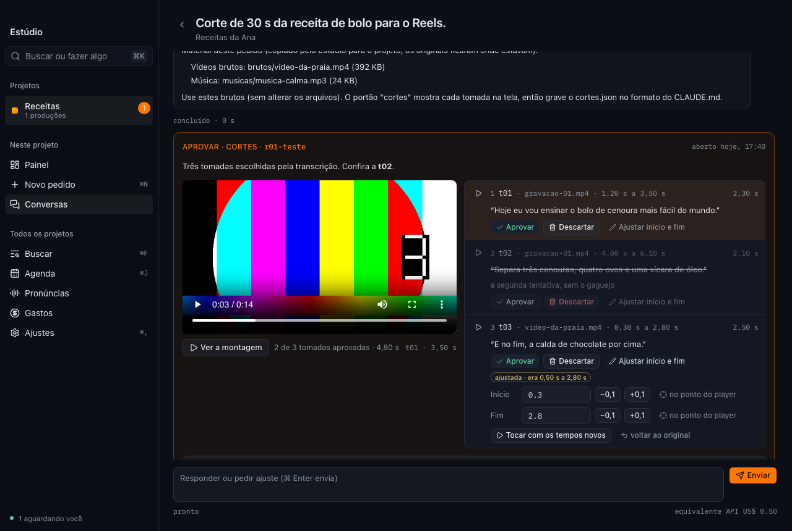
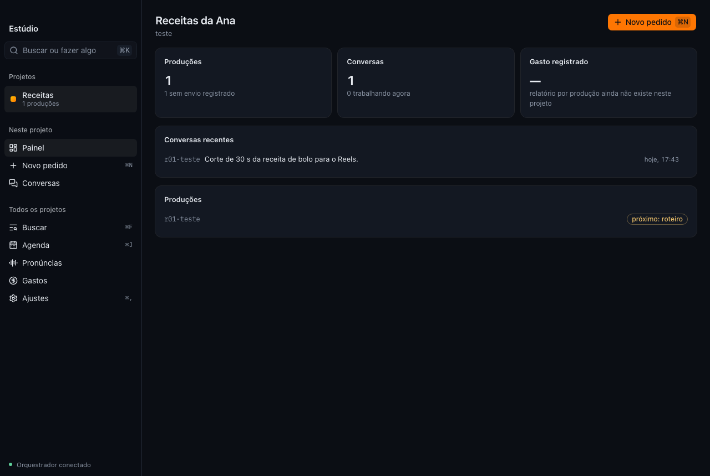
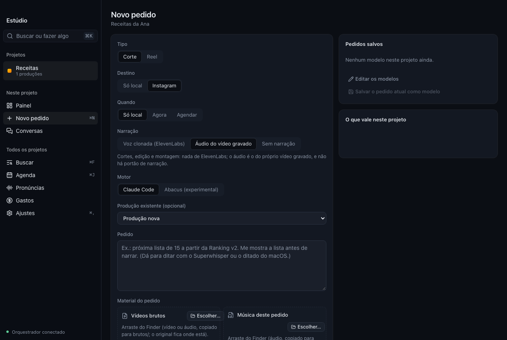
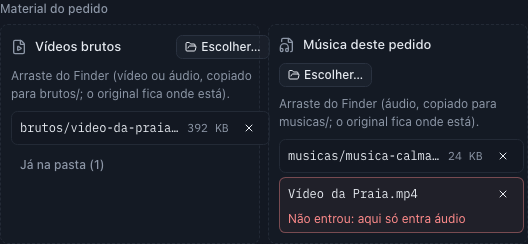
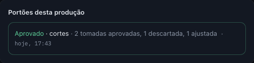
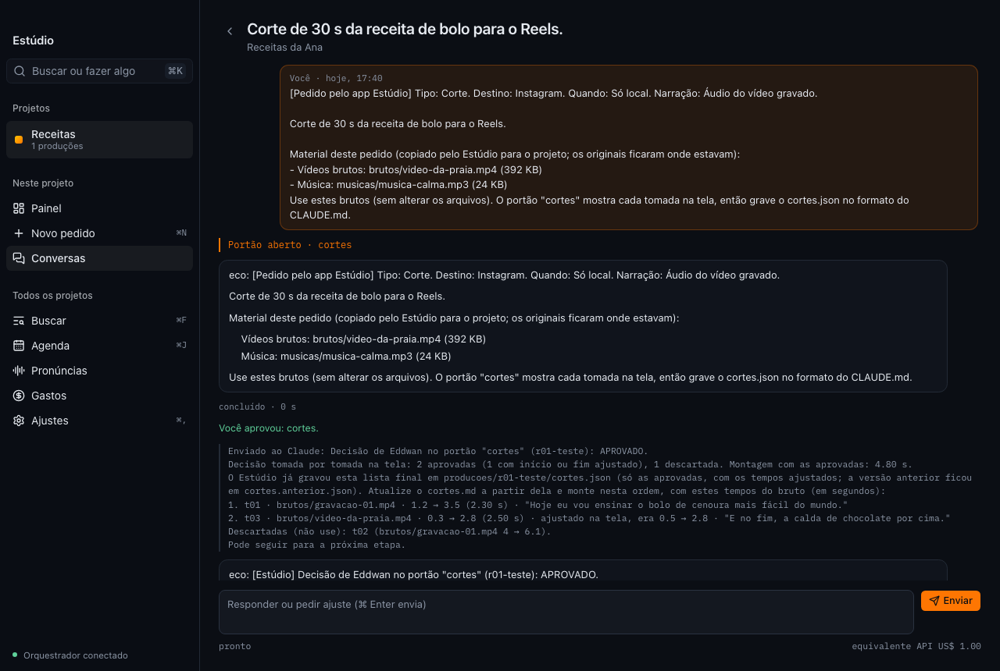
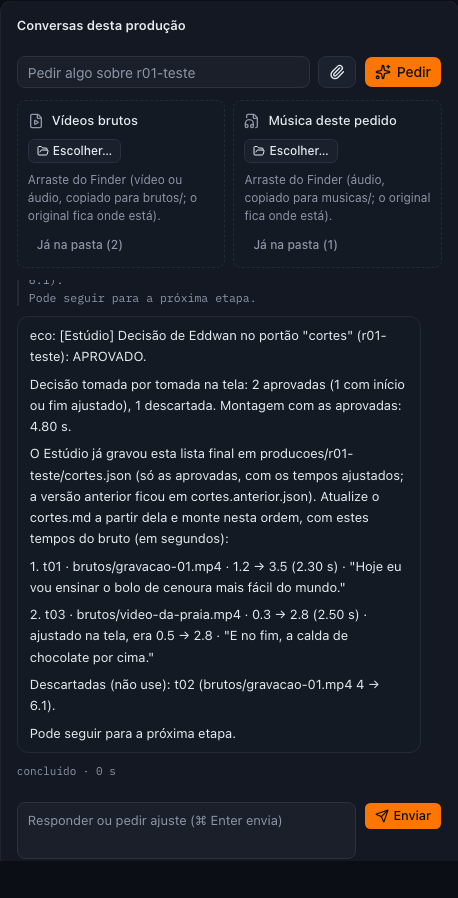

# Estúdio

**Peça o vídeo, aprove cada etapa e receba pronto.**
App de Mac da Hallen Tech para produzir vídeos com inteligência artificial, do material gravado ao corte final.

[**Baixar a versão mais nova**](https://github.com/hallentech/estudio-releases/releases/latest)

Para Mac com Apple Silicon ou Intel

## O que é

O Estúdio junta, numa janela só, tudo o que acontece numa produção de vídeo feita com IA. Você escreve o pedido
("corte de 30 s da receita de bolo para o Reels"), solta os vídeos gravados e a música, e a IA trabalha no seu Mac:
transcreve, escolhe as tomadas, corta, monta, coloca a música por baixo da fala e legenda. Em cada etapa importante
ela para e espera a sua aprovação, com o material na tela para você conferir.

A IA roda pelo **Claude Code** ou pelo **Abacus**, com a sua própria conta. Os vídeos, os projetos e as conversas
ficam no seu Mac.

## Por dentro

### Painel de cada projeto

Produções, conversas e o que está esperando por você, projeto por projeto.

### Novo pedido

Tipo, destino, quando publicar, narração (voz clonada, áudio do próprio vídeo ou sem narração) e o motor de IA de cada
pedido. Os vídeos brutos e a música entram arrastando do Finder.

### Aprovação tomada por tomada

A IA propõe os cortes e o Estúdio mostra cada tomada com o player do trecho, a duração e o que é falado. Você aprova,
descarta ou ajusta o início e o fim (com o ponto do player), vê a montagem antes de aprovar, e a decisão volta para a
IA com a lista final.

### A conversa com a IA

Cada pedido vira uma conversa: o que a IA fez, os comandos que rodou, as decisões das etapas e o que vem em seguida.
Dá para pedir ajustes a qualquer momento, também de dentro da produção.

## Destaques

- **Primeira abertura guiada:** seu nome, a pasta dos projetos, o motor de IA (com a situação do login) e as
  ferramentas do Mac, e o primeiro projeto já pronto a partir do modelo "Cortes e montagens".
- **Etapas com aprovação:** cortes, narração e vídeo final esperam o seu OK, mesmo com o app fechado no meio.
- **Avisos do macOS:** quando a IA precisa de você, o aviso leva direto para a conversa que está esperando.
- **Barra de menus do Mac, ⌘K para buscar e fazer** e tema claro ou escuro conforme o sistema.
- **@ para citar outro projeto** no pedido, para a IA consultar materiais de lá sem misturar as regras.
- **Gastos por produção:** o custo de cada vídeo, somando a IA e a voz.

## Instalar

1. Baixe o `.dmg` da [versão mais nova](https://github.com/hallentech/estudio-releases/releases/latest).
2. Abra o `.dmg` e arraste o **Estúdio** para **Aplicativos**.
3. Abra o Estúdio. Ele é assinado com o Developer ID da Hallen Tech e notarizado pela Apple: abre direto, sem aviso
   de app desconhecido.
4. Na primeira abertura, siga o passo a passo. Você vai precisar do **Claude Code** ou do **Abacus CLI** instalado e
   com login na sua conta, e do **ffmpeg** para cortar os vídeos (o próprio Estúdio mostra os comandos de instalação).

## Atualizações

A partir da 0.2.0, o Estúdio se atualiza sozinho: quando sai uma versão nova, ele avisa em Ajustes → Sistema e instala
com um clique. Cada pacote é assinado; o app só aceita atualizações com a assinatura da Hallen Tech. Seus projetos,
conversas e preferências não são tocados pela atualização.

## Sobre este repositório

Aqui ficam só os pacotes de cada versão: o `.dmg` para instalar e o pacote da atualização automática
(`.app.tar.gz`, a assinatura `.sig` e o `latest.json`). O código-fonte do Estúdio não é público.

Feito pela <a href="https://hallentech.com">Hallen Tech</a>.

